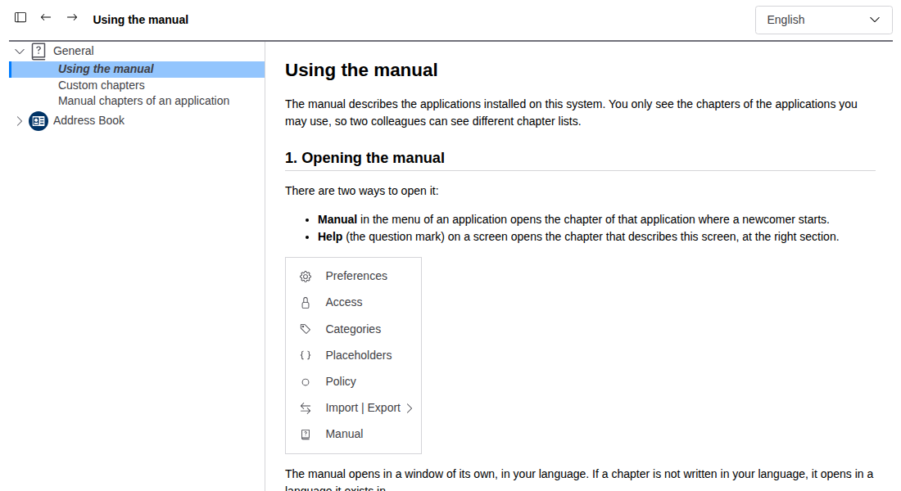

# egwmanual – the user manual inside EGroupware

egwmanual shows the user manual of every installed EGroupware application in a popup window, and lets the
administrators complete it with their own chapters from the filemanager.

- **Chapters come with the applications**: Markdown files in `<app>/doc/manual/<lang>/`, found automatically. A user
  sees only the chapters of the applications they may use.
- **"Manual" in every application's menu** and in the user menu (top right, for the application in front), and
  Help buttons that open a chapter at a section.
- **Languages**: the window opens in the user's language, and a selector at the top switches it. If a chapter is not
  written in the user's language, it opens in one it exists in.
- **Custom chapters** from a filemanager folder: add chapters (also for applications without a manual), replace or
  hide shipped ones, or **append** your organisation's text to a chapter, at its end or after a given section.
- **Sub-chapters**: a chapter whose first line is `<!-- parent: <chapter> -->` is listed below that chapter, shipped or
  custom; short section chapters group chapters by topic, also under General.
- **Live parts**: an application can fill tables of a chapter from its own setup (statuses, types …).
- **No dependencies** besides the EGroupware API. Applications don't depend on egwmanual to ship chapters; only
  their Help buttons need it.

The manual of the manual is in [doc/manual](doc/manual/en/00-manual.md) (English, German and Greek):
[using it](doc/manual/en/00-manual.md), [custom chapters](doc/manual/en/01-manual-custom-chapters.md) and
[chapters of an application](doc/manual/en/02-manual-for-developers.md).



## Installation

1. Put the repository into the EGroupware directory as `egwmanual/`
   (`git clone <url> egwmanual`, next to `api/`, `addressbook/` …).
2. Install it in setup (Setup › Manage applications), or on the command line:
   `php setup/setup-cli.php --update <domain>,<config user>,<config password>,,egwmanual`.
   The Default group gets the right to use it.
3. Build the JavaScript: `npm run build` (EGroupware's rollup build picks up `egwmanual/js/app.ts`).
4. Admin › Clear cache/register hooks, so that every application's menu gets the entry.

It needs EGroupware 23.1 or later (developed on 26.x) and PHP 8.1+. The PHP extension `intl` is optional (language
names in their own language).

## Configuration

**Admin › Manual › App configuration**:

| Setting | Meaning |
|---|---|
| Use custom chapters from a folder of the filemanager | Off by default: the folder is then neither checked nor read. |
| Language of the manual when the user's own language has no chapters | Fallback language. |
| Folder of the custom chapters (filemanager) | e.g. `/manual`, required when switched on. |
| Editors | The group allowed to write into that folder; empty means Admins. |

Layout of the custom folder:

```
<folder>/<lang>/<app>/<chapter>.md           new chapter, or replaces the shipped chapter of that name (empty: hides it)
<folder>/<lang>/<app>/<chapter>.append.md    appended to the chapter; first line "<!-- after: <anchor> -->" inserts it
                                             after that section
<folder>/<lang>/<app>/images/<picture>       png, jpeg, gif, webp
```

`<app>` is an application name or `general`. Details: [custom chapters](doc/manual/en/01-manual-custom-chapters.md).

## Security

Chapters are shown to many users and custom chapters can be written by administrators, so the following rules
apply:

- **Nothing in a chapter is ever executed.** The renderer (`src/Renderer.php`) escapes all text first and then
  adds a fixed set of tags. Raw HTML shows as text. Links may only go to other chapters, `#anchors` and
  `http(s)://` (opened with `noopener noreferrer`). Pictures come only from the application's own manual folder,
  the custom folder, or as image `data:` URLs. Pictures from other sites are dropped, so readers can't be tracked.
- **Custom chapters are off by default.** Switched on, they are **read as root** (every user of the manual sees them, whatever their filemanager rights).
  So the trust boundary is who can write the folder. `src/Security.php` checks it when the configuration is saved
  and again at least every 5 minutes. The folder must be a plain folder of the database filesystem (no symlink, no
  other mount). Every entry must belong to root or an editor, may not be world-writable, may be group-writable only
  for the editors group, and no extended ACL (on it or a folder above it) may give write access to anybody else.
  If the check fails, the custom chapters are ignored and administrators see a warning in the manual window.
- **Reading is contained** (`src/Custom.php`): root only for the read itself (and the stat cache cleared on both
  sides). Only files listed from the folder are read, never through a symlink. Names must match strict patterns,
  and sizes are limited (chapter 512 KB, picture 5 MB, 1000 files per language).
- **Pictures of the custom folder** (`Ui::image`): png/jpeg/gif/webp only (no SVG), and the content must match the
  extension. They are sent with `X-Content-Type-Options: nosniff` and `Content-Security-Policy: default-src 'none';
  sandbox`. They work for users without filemanager rights.
- **Live parts** call only `<app>_manual::block_<name>()` of applications the reader has, with arguments limited to
  `[A-Za-z0-9_-]`. Their output is escaped like any other text.

Please report security issues privately to the maintainer instead of opening a public issue.

## For application developers

Put the chapters into `<app>/doc/manual/<lang>/` and link Help buttons to them:

```xml
<et2-button-icon label="Help" image="question-circle" noSubmit="true"
  onclick="egw.openPopup(egw.link('/index.php', {menuaction: 'egwmanual.EGroupware\\Egwmanual\\Ui.page',
  page: '40-myapp-guide-00-basics', anchor: ''}), 920, 850, 'egwmanual'); return false;"/>
```

From PHP: `\EGroupware\Egwmanual\Manual::link($page, $anchor)`. The optional hook `manual_start` names the chapter
the menu entry opens, and `<!-- live: myapp.name -->` blocks are filled by `myapp_manual::block_name($lang)`.
See [chapters of an application](doc/manual/en/02-manual-for-developers.md).

## Code

| Path | What it does |
|---|---|
| `src/Renderer.php` | Markdown subset → HTML, escape first |
| `src/Chapters.php` | which chapters a reader has: shipped + custom, overrides, hidden, appends, chapter tree |
| `src/Custom.php` | the custom folder in the filemanager (read as root, contained) |
| `src/Security.php` | the write-rights check of the custom folder |
| `src/Manual.php` | entry points: `link()`, `html()`, language choice, picture URLs, live parts |
| `src/Ui.php` | the window (`Ui.page`) and the pictures of the custom folder (`Ui.image`) |
| `src/Hooks.php` | menu entry in every application (`sidebox_all`), admin, site configuration |
| `templates/default/` | `manual.xet` (window), `config.xet`, `app.css` |
| `js/app.ts` | chapter tree, language switch, scrolling to a section |

## Tests

PHPUnit, run inside the EGroupware container as the web server user:

```
vendor/bin/phpunit -c doc/phpunit.xml egwmanual/tests/RendererTest.php egwmanual/tests/ChaptersTest.php
vendor/bin/phpunit -c doc/phpunit.xml egwmanual/tests/VfsSecurityTest.php     # needs a login (LoggedInTest)
```

- `RendererTest`: the Markdown subset, and that no markup, event handler or active link gets through.
- `ChaptersTest`: shipped and custom chapters, overrides, hiding, appends, languages, live parts. It also
  renders every chapter of the installation.
- `VfsSecurityTest`: a real folder in the filemanager. It covers symlinks, path traversal, disguised pictures,
  owner/mode/ACL checks, and root being given back after errors. The test creates and removes its own folders.

## License

GPL-2.0-or-later, like EGroupware.
