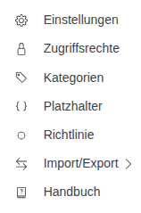
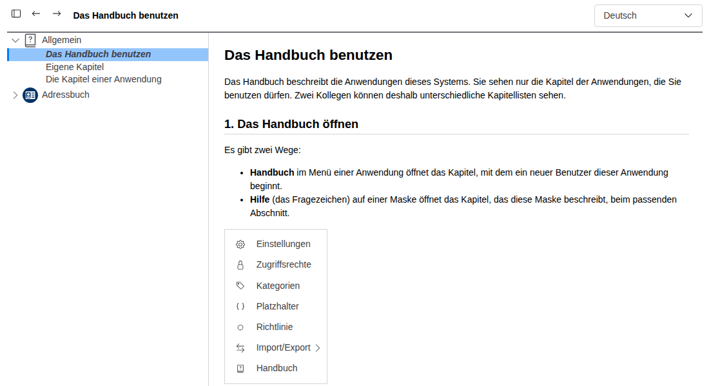
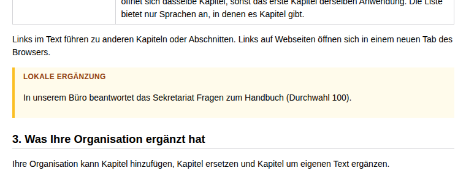

# Das Handbuch benutzen

Das Handbuch beschreibt die Anwendungen dieses Systems. Sie sehen nur die Kapitel der Anwendungen, die Sie benutzen
dürfen. Zwei Kollegen können deshalb unterschiedliche Kapitellisten sehen.

## 1. Das Handbuch öffnen

Es gibt drei Wege:

- **Handbuch** im Menü einer Anwendung öffnet das Kapitel, mit dem ein neuer Benutzer dieser Anwendung beginnt.
- **Hilfe** (das Fragezeichen) auf einer Maske öffnet das Kapitel, das diese Maske beschreibt, beim passenden Abschnitt.
- **Handbuch** im Benutzermenü (Ihr Bild oben rechts) öffnet das Handbuch der Anwendung, in der Sie gerade sind.

Das Handbuch öffnet sich in einem eigenen Fenster und in Ihrer Sprache. Gibt es ein Kapitel nicht in Ihrer Sprache,
öffnet es sich in einer Sprache, in der es vorhanden ist.

## 2. Das Fenster

| Teil | Was er tut |
|---|---|
| Kapitelliste (links) | Ein Eintrag je Anwendung, darunter ihre Kapitel. Ein Klick auf ein Kapitel öffnet es. **Allgemein** enthält die Kapitel, die zu keiner Anwendung gehören. Ein Kapitel mit Unterkapiteln hat einen Pfeil, der sie aufklappt. |
| Kapitelliste ein- oder ausblenden (erster Knopf) | Blendet die Liste aus, damit das Kapitel mehr Platz hat. Das Handbuch merkt sich Ihre Wahl. |
| Zurück / Vorwärts (Pfeile) | Wechselt zwischen den Kapiteln, die Sie geöffnet haben, wie in einem Webbrowser. |
| Sprache (oben rechts) | Zeigt das Handbuch in einer anderen Sprache. Gibt es das Kapitel in dieser Sprache, öffnet sich dasselbe Kapitel, sonst das erste Kapitel derselben Anwendung. Die Liste bietet nur Sprachen an, in denen es Kapitel gibt. |

Links im Text führen zu anderen Kapiteln oder Abschnitten. Links auf Webseiten öffnen sich in einem neuen Tab des
Browsers.

## 3. Was Ihre Organisation ergänzt hat

Ihre Organisation kann Kapitel hinzufügen, Kapitel ersetzen und Kapitel um eigenen Text ergänzen.

- Kapitel, die sie hinzugefügt oder geändert hat, stehen *kursiv* in der Kapitelliste.
- Text, den sie einem Kapitel hinzugefügt hat, steht in einem Rahmen mit der Überschrift **Lokale Ergänzung**.

Sagen das Kapitel und die lokale Ergänzung Verschiedenes, gilt die lokale Ergänzung: Sie beschreibt, wie Ihre
Organisation arbeitet.

## 4. Für Administratoren und Entwickler

- Kapitel hinzufügen, ersetzen und ausblenden: [Eigene Kapitel](01-manual-custom-chapters.md).
- Das Handbuch einer Anwendung schreiben: [Die Kapitel einer Anwendung](02-manual-for-developers.md).
