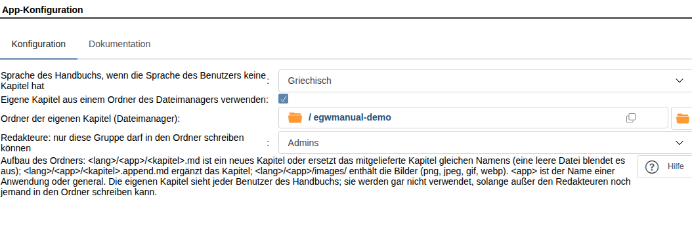
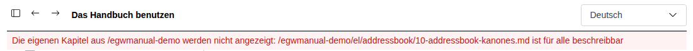

# Eigene Kapitel

Administratoren können das Handbuch um eigenen Text ergänzen. Der Text liegt als Markdown-Dateien (`.md`) in einem
Ordner des Dateimanagers. Die Anwendungen müssen dafür nicht geändert werden.

Mit eigenen Kapiteln können Sie:

- ein Kapitel hinzufügen, auch für eine Anwendung ohne eigenes Handbuch (zum Beispiel das Adressbuch),
- ein Kapitel einer Anwendung durch eine eigene Fassung ersetzen,
- ein Kapitel ausblenden,
- ein Kapitel um Text ergänzen, am Ende oder nach einem seiner Abschnitte.

## 1. Den Ordner einrichten

1. Legen Sie im Dateimanager einen Ordner an, zum Beispiel `/manual`.
2. Geben Sie Schreibrecht auf diesen Ordner **nur** den Redakteuren des Handbuchs (standardmäßig der Gruppe Admins).
   Der Ordner und alles darin muss einem Redakteur oder root gehören. Kein anderer Benutzer und keine andere Gruppe darf
   hineinschreiben können, weder über die Rechte des Ordners noch über eine erweiterte ACL des Ordners oder eines
   Ordners darüber.
3. Öffnen Sie **Admin › Handbuch › App-Konfiguration**, kreuzen Sie **Eigene Kapitel aus einem Ordner des Dateimanagers
   verwenden** an und füllen Sie aus:



| Feld | Was Sie eintragen |
|---|---|
| Eigene Kapitel aus einem Ordner des Dateimanagers verwenden | Ankreuzen. Standardmäßig ist es aus: Dann wird der Ordner weder geprüft noch gelesen, und seine beiden Felder sind ausgegraut. |
| Sprache des Handbuchs, wenn die Sprache des Benutzers keine Kapitel hat | Die Sprache, in der die meisten Kapitel geschrieben sind. |
| Ordner der eigenen Kapitel (Dateimanager) | Den Ordner aus Schritt 1, zum Beispiel `/manual`. |
| Redakteure: nur diese Gruppe darf in den Ordner schreiben können | Die Gruppe der Redakteure. Leer bedeutet Admins. |

Eingeschaltet wird die Konfiguration nur gespeichert, wenn der Ordner die Prüfung aus Schritt 2 besteht. Die Meldung nennt jede
Datei und jeden Ordner, die sie nicht bestehen, und den Grund.

> Jeder Benutzer des Handbuchs sieht alle eigenen Kapitel der Anwendungen, die er benutzen darf, unabhängig von seinen
> Rechten im Dateimanager. Legen Sie nichts in den Ordner, was nicht alle Benutzer lesen dürfen.

## 2. Aufbau des Ordners

| Datei | Was sie tut |
|---|---|
| `<lang>/<app>/<kapitel>.md` | Ein neues Kapitel der Anwendung, oder der Ersatz für das gleichnamige Kapitel der Anwendung. |
| `<lang>/<app>/<kapitel>.md`, leer | Blendet das gleichnamige Kapitel der Anwendung aus. |
| `<lang>/<app>/<kapitel>.append.md` | Text, der dem Kapitel hinzugefügt wird (mitgeliefert, ersetzt oder eigen). |
| `<lang>/<app>/images/<bild>` | Bilder dieser Kapitel: png, jpeg, gif oder webp. |

- `<lang>` ist ein Sprachcode: `de`, `en`, `el`, `pt-br` …
- `<app>` ist der Name einer Anwendung (`addressbook`, `calendar`, `infolog` …) oder `general` für Kapitel, die zu
  keiner Anwendung gehören. Ein Kapitel einer Anwendung sehen nur die Benutzer dieser Anwendung.
- `<kapitel>` besteht nur aus Kleinbuchstaben ohne Umlaute, Ziffern und Bindestrichen, zum Beispiel
  `10-addressbook-unsere-regeln`. Die Kapitel stehen in der Reihenfolge ihrer Namen, beginnen Sie sie also mit einer
  Zahl.

Die Namen der Kapitel sind in allen Sprachen gleich: Die Übersetzung eines Kapitels hat im Ordner der anderen Sprache
denselben Dateinamen. Um ein Kapitel einer Anwendung zu ersetzen oder auszublenden, verwenden Sie seinen Dateinamen im
Ordner derselben Anwendung (die Hilfe-Knöpfe öffnen das Kapitel unter diesem Namen). Den Namen eines Kapitels sehen Sie
in der Adresse des Handbuch-Fensters (`page=…`).

Beispiel:

```
/manual
  de/
    general/
      05-unsere-buerozeiten.md
    addressbook/
      10-addressbook-unsere-regeln.md
      images/
        neuer-kontakt.png
    infolog/
      20-infolog-einfuehrung.md          (leer: blendet das Kapitel aus)
      21-infolog-status.append.md
```

## 3. Ein Kapitel schreiben

Die erste Überschrift (`# Titel`) ist der Titel in der Kapitelliste. Das Handbuch zeigt diesen Teil von Markdown:

- Überschriften `#` bis `######`, Absätze, Listen (auch nummeriert und verschachtelt), Tabellen, Zitate `>`, Code in
  Backticks und Codeblöcke, **fett**, *kursiv*, waagrechte Linien `---`;
- Links auf andere Kapitel: `[Text](10-addressbook-unsere-regeln.md)` oder mit Abschnitt
  `[Text](10-addressbook-unsere-regeln.md#2-wer-darf-ändern)`; Links auf Webseiten, die mit `https://` beginnen;
- Bilder: ``.

HTML in einem Kapitel erscheint als Text und wird nie ausgeführt. Links anderer Art (`javascript:`, `data:`, Pfade)
erscheinen als einfacher Text. Bilder von anderen Webseiten werden nicht angezeigt: Die Webseite könnte sonst sehen,
wer welches Kapitel liest.

Der Anker eines Abschnitts entsteht wie auf GitHub: Kleinbuchstaben, Leerzeichen werden zu Bindestrichen, Satzzeichen
entfallen (`## 2. Wer darf ändern` → `2-wer-darf-ändern`).

Eine Kapiteldatei darf höchstens 512 KB groß sein, ein Bild höchstens 5 MB.

## 4. Ein Kapitel ergänzen

Eine Datei `<kapitel>.append.md` wird am Ende des Kapitels angefügt. Soll sie stattdessen nach einem Abschnitt stehen,
beginnen Sie sie mit

```
<!-- after: 2-wer-darf-ändern -->
```

Der Text steht dann nach diesem Abschnitt, vor der nächsten Überschrift gleicher oder höherer Ebene. Gibt es den
Abschnitt nicht (mehr), wird der Text am Ende angefügt. Die Leser sehen ihn in einem Rahmen mit der Überschrift
**Lokale Ergänzung**.

Eine Ergänzung ist die bessere Wahl, wenn Sie nur die Regeln Ihrer Organisation hinzufügen wollen: Das mitgelieferte
Kapitel bleibt dann mit jeder neuen Version aktuell, ein ersetztes Kapitel nicht.

## 5. Tabellen, die die Anwendungen berechnen

Manche Kapitel enthalten Tabellen, die die Anwendung aus ihrer eigenen Einrichtung berechnet (zum Beispiel ihre
Status). Sie sind so markiert:

```
<!-- live: <app>.<name> -->
Text, der erscheint, wenn die Tabelle nicht berechnet werden kann.
<!-- /live -->
```

Ein solcher Block kann auch in einem eigenen Kapitel stehen. Er wird nur für Benutzer dieser Anwendung ausgefüllt.

## 6. Wenn eigene Kapitel nicht erscheinen

| Was Sie sehen | Grund | Was Sie tun |
|---|---|---|
| Gar kein eigenes Kapitel, und keine Warnung | **Eigene Kapitel aus einem Ordner des Dateimanagers verwenden** ist nicht angekreuzt. | Ankreuzen und die Konfiguration speichern. |
| Eine rote Zeile oben im Fenster des Handbuchs (nur Administratoren) | Außer den Redakteuren kann noch jemand in den Ordner schreiben. Alle eigenen Kapitel sind abgeschaltet. | Korrigieren Sie die Rechte, die die Zeile nennt. Die Kapitel erscheinen nach spätestens fünf Minuten wieder, sofort nach erneutem Speichern der Konfiguration. |
| Ein Kapitel fehlt | Falscher Ordner (`<lang>/<app>/`), ein Name mit Großbuchstaben, Leerzeichen oder Umlauten, oder der Benutzer hat die Anwendung nicht. | Benennen Sie die Datei um oder verschieben Sie sie. |
| Ein ersetztes Kapitel zeigt den ursprünglichen Text | Die Datei liegt im Ordner einer anderen Anwendung als das ursprüngliche Kapitel. | Verschieben Sie sie in den Ordner der Anwendung des Kapitels. |
| Ein Bild fehlt | Kein png, jpeg, gif oder webp, der Inhalt passt nicht zum Typ, oder es liegt nicht direkt in `images/`. | Speichern Sie es erneut als png oder jpeg. |


