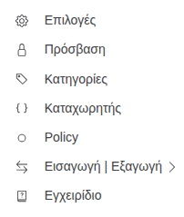
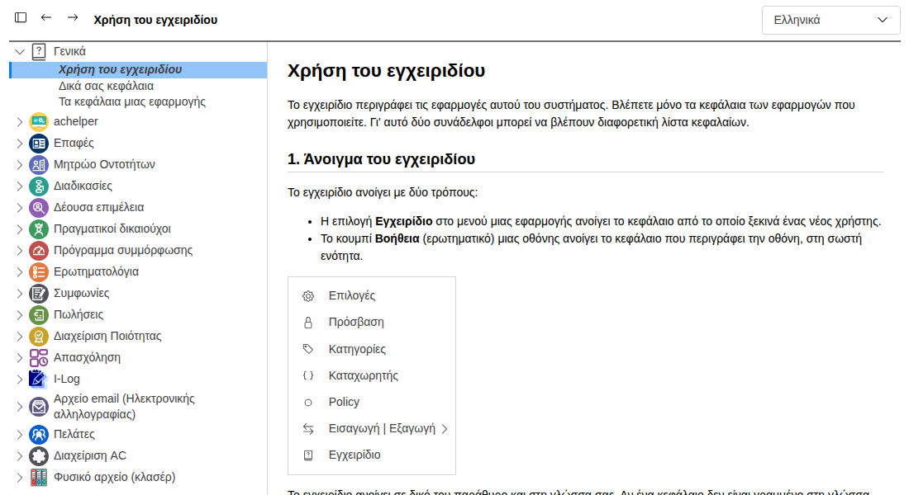
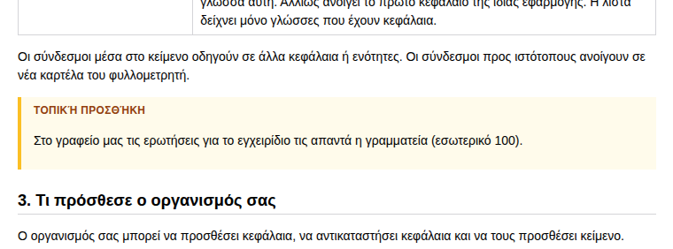

# Χρήση του εγχειριδίου

Το εγχειρίδιο περιγράφει τις εφαρμογές αυτού του συστήματος. Βλέπετε μόνο τα κεφάλαια των εφαρμογών που
χρησιμοποιείτε. Γι' αυτό δύο συνάδελφοι μπορεί να βλέπουν διαφορετική λίστα κεφαλαίων.

## 1. Άνοιγμα του εγχειριδίου

Το εγχειρίδιο ανοίγει με τρεις τρόπους:

- Η επιλογή **Εγχειρίδιο** στο μενού μιας εφαρμογής ανοίγει το κεφάλαιο από το οποίο ξεκινά ένας νέος χρήστης.
- Το κουμπί **Βοήθεια** (ερωτηματικό) μιας οθόνης ανοίγει το κεφάλαιο που περιγράφει την οθόνη, στη σωστή ενότητα.
- Η επιλογή **Εγχειρίδιο** στο μενού του χρήστη (η εικόνα σας πάνω δεξιά) ανοίγει το εγχειρίδιο της εφαρμογής στην οποία
  βρίσκεστε.

Το εγχειρίδιο ανοίγει σε δικό του παράθυρο και στη γλώσσα σας. Αν ένα κεφάλαιο δεν είναι γραμμένο στη γλώσσα σας,
ανοίγει σε μια γλώσσα στην οποία υπάρχει.

## 2. Το παράθυρο

| Μέρος | Τι κάνει |
|---|---|
| Λίστα κεφαλαίων (αριστερά) | Μία εγγραφή ανά εφαρμογή, με τα κεφάλαιά της από κάτω. Με κλικ σε ένα κεφάλαιο, αυτό ανοίγει. Η εγγραφή **Γενικά** έχει τα κεφάλαια που δεν ανήκουν σε εφαρμογή. |
| Εμφάνιση ή απόκρυψη της λίστας κεφαλαίων (πρώτο κουμπί) | Κρύβει τη λίστα, για να έχει το κεφάλαιο περισσότερο χώρο. Το εγχειρίδιο θυμάται την επιλογή σας. |
| Πίσω / Εμπρός (βέλη) | Μετακινεί ανάμεσα στα κεφάλαια που ανοίξατε, όπως σε έναν φυλλομετρητή. |
| Γλώσσα (πάνω δεξιά) | Δείχνει το εγχειρίδιο σε άλλη γλώσσα. Ανοίγει το ίδιο κεφάλαιο, αν υπάρχει στη γλώσσα αυτή. Αλλιώς ανοίγει το πρώτο κεφάλαιο της ίδιας εφαρμογής. Η λίστα δείχνει μόνο γλώσσες που έχουν κεφάλαια. |

Οι σύνδεσμοι μέσα στο κείμενο οδηγούν σε άλλα κεφάλαια ή ενότητες. Οι σύνδεσμοι προς ιστότοπους ανοίγουν σε νέα καρτέλα
του φυλλομετρητή.

## 3. Τι πρόσθεσε ο οργανισμός σας

Ο οργανισμός σας μπορεί να προσθέσει κεφάλαια, να αντικαταστήσει κεφάλαια και να τους προσθέσει κείμενο.

- Τα κεφάλαια που πρόσθεσε ή άλλαξε εμφανίζονται με *πλάγια* γράμματα στη λίστα κεφαλαίων.
- Το κείμενο που πρόσθεσε σε ένα κεφάλαιο εμφανίζεται σε πλαίσιο με τίτλο **Τοπική προσθήκη**.

Αν το κείμενο του κεφαλαίου και η τοπική προσθήκη λένε διαφορετικά πράγματα, ακολουθήστε την τοπική προσθήκη. Αυτή
περιγράφει πώς δουλεύει ο οργανισμός σας.

## 4. Για διαχειριστές και προγραμματιστές

- Προσθήκη, αντικατάσταση και απόκρυψη κεφαλαίων: [Δικά σας κεφάλαια](01-manual-custom-chapters.md).
- Συγγραφή του εγχειριδίου μιας εφαρμογής: [Τα κεφάλαια μιας εφαρμογής](02-manual-for-developers.md).
