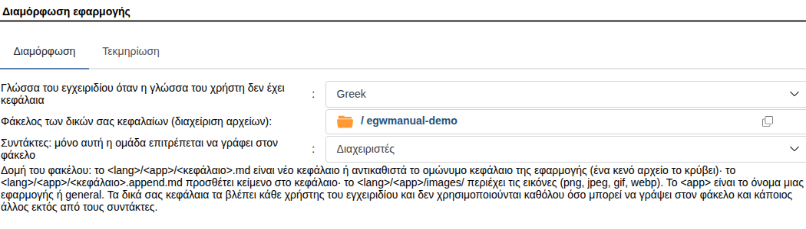
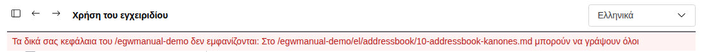

# Δικά σας κεφάλαια

Οι διαχειριστές μπορούν να συμπληρώσουν το εγχειρίδιο με δικό τους κείμενο. Το κείμενο γράφεται σε αρχεία Markdown
(`.md`) σε έναν φάκελο του Διαχειριστή αρχείων. Οι εφαρμογές δεν χρειάζεται να αλλάξουν.

Με δικά σας κεφάλαια μπορείτε:

- να προσθέσετε κεφάλαιο, και για εφαρμογή που δεν έχει δικό της εγχειρίδιο (για παράδειγμα τις Επαφές)·
- να αντικαταστήσετε ένα κεφάλαιο μιας εφαρμογής με δική σας εκδοχή·
- να κρύψετε ένα κεφάλαιο·
- να προσθέσετε κείμενο σε ένα κεφάλαιο, στο τέλος του ή μετά από μια ενότητά του.

## 1. Ρύθμιση του φακέλου

1. Δημιουργήστε έναν φάκελο στον Διαχειριστή αρχείων, για παράδειγμα `/manual`.
2. Δώστε δικαίωμα εγγραφής στον φάκελο **μόνο** στους συντάκτες του εγχειριδίου (από προεπιλογή η ομάδα Admins).
   Ο φάκελος και ό,τι περιέχει πρέπει να ανήκουν σε συντάκτη ή στον root. Κανένας άλλος χρήστης ή ομάδα δεν επιτρέπεται
   να γράφει σε αυτόν. Αυτό ισχύει για τα δικαιώματα του φακέλου και για τα εκτεταμένα δικαιώματα (ACL) του φακέλου ή
   ενός φακέλου πάνω από αυτόν.
3. Ανοίξτε **Διαχειριστής › Εγχειρίδιο › Διαμόρφωση εφαρμογής**, επιλέξτε **Χρήση δικών σας κεφαλαίων από φάκελο του
   Διαχειριστή αρχείων** και συμπληρώστε τα πεδία:



| Πεδίο | Τι συμπληρώνετε |
|---|---|
| Χρήση δικών σας κεφαλαίων από φάκελο του Διαχειριστή αρχείων | Επιλέξτε το. Από προεπιλογή είναι ανενεργό. Τότε ο φάκελος δεν ελέγχεται ούτε διαβάζεται, και τα δύο πεδία του είναι γκρίζα. |
| Γλώσσα του εγχειριδίου όταν η γλώσσα του χρήστη δεν έχει κεφάλαια | Τη γλώσσα στην οποία είναι γραμμένα τα περισσότερα κεφάλαια. |
| Φάκελος των δικών σας κεφαλαίων (διαχείριση αρχείων) | Τον φάκελο του βήματος 1, για παράδειγμα `/manual`. |
| Συντάκτες: μόνο αυτή η ομάδα επιτρέπεται να γράφει στον φάκελο | Την ομάδα των συντακτών. Κενό σημαίνει Admins. |

Όταν η επιλογή είναι ενεργή, οι ρυθμίσεις αποθηκεύονται μόνο αν ο φάκελος περάσει τον έλεγχο του βήματος 2. Το μήνυμα αναφέρει κάθε αρχείο ή φάκελο
που δεν τον περνά και τον λόγο.

> Κάθε χρήστης του εγχειριδίου βλέπει όλα τα δικά σας κεφάλαια των εφαρμογών που χρησιμοποιεί, ανεξάρτητα από τα
> δικαιώματά του στον Διαχειριστή αρχείων. Μη βάζετε στον φάκελο τίποτα που δεν επιτρέπεται να διαβάσουν όλοι.

## 2. Δομή του φακέλου

| Αρχείο | Τι κάνει |
|---|---|
| `<lang>/<app>/<κεφάλαιο>.md` | Νέο κεφάλαιο της εφαρμογής ή αντικατάσταση του ομώνυμου κεφαλαίου της εφαρμογής. |
| `<lang>/<app>/<κεφάλαιο>.md`, κενό | Κρύβει το ομώνυμο κεφάλαιο της εφαρμογής. |
| `<lang>/<app>/<κεφάλαιο>.append.md` | Κείμενο που προστίθεται στο κεφάλαιο (της εφαρμογής, αντικατεστημένο ή δικό σας). |
| `<lang>/<app>/images/<εικόνα>` | Εικόνες αυτών των κεφαλαίων: png, jpeg, gif ή webp. |

- Το `<lang>` είναι κωδικός γλώσσας: `el`, `en`, `de`, `pt-br` …
- Το `<app>` είναι το όνομα μιας εφαρμογής (`addressbook`, `calendar`, `infolog` …) ή `general` για κεφάλαια που δεν
  ανήκουν σε εφαρμογή. Το κεφάλαιο μιας εφαρμογής το βλέπουν μόνο οι χρήστες της εφαρμογής.
- Το όνομα του κεφαλαίου έχει μόνο πεζά λατινικά γράμματα, ψηφία και παύλες, για παράδειγμα `10-addressbook-kanones`.
  Τα κεφάλαια εμφανίζονται με τη σειρά των ονομάτων τους. Γι' αυτό ξεκινήστε τα με αριθμό.

Τα ονόματα των κεφαλαίων είναι ίδια σε όλες τις γλώσσες. Η μετάφραση ενός κεφαλαίου έχει το ίδιο όνομα αρχείου στον
φάκελο της άλλης γλώσσας. Για να αντικαταστήσετε ή να κρύψετε ένα κεφάλαιο μιας εφαρμογής, χρησιμοποιήστε το όνομα
αρχείου του, στον φάκελο της ίδιας εφαρμογής. Τα κουμπιά Βοήθεια ανοίγουν το κεφάλαιο με αυτό το όνομα. Το όνομα ενός
κεφαλαίου φαίνεται στη διεύθυνση του παραθύρου του εγχειριδίου (`page=…`).

Παράδειγμα:

```
/manual
  el/
    general/
      05-orario-grafeiou.md
    addressbook/
      10-addressbook-kanones.md
      images/
        nea-epafi.png
    infolog/
      20-infolog-eisagogi.md          (κενό: κρύβει το κεφάλαιο)
      21-infolog-katastaseis.append.md
```

## 3. Γράψιμο ενός κεφαλαίου

Η πρώτη επικεφαλίδα (`# Τίτλος`) είναι ο τίτλος στη λίστα κεφαλαίων. Το εγχειρίδιο δείχνει τα εξής στοιχεία Markdown:

- επικεφαλίδες `#` έως `######`, παραγράφους, λίστες (και αριθμημένες και εμφωλευμένες), πίνακες, παραθέματα `>`,
  κώδικα μέσα σε backticks και μπλοκ κώδικα, **έντονα**, *πλάγια*, οριζόντιες γραμμές `---`·
- συνδέσμους προς άλλα κεφάλαια: `[κείμενο](10-addressbook-kanones.md)` ή με ενότητα
  `[κείμενο](10-addressbook-kanones.md#2-ποιος-αλλάζει)`· συνδέσμους προς ιστότοπους που αρχίζουν με `https://`·
- εικόνες: ``.

Η HTML μέσα σε ένα κεφάλαιο εμφανίζεται ως κείμενο και δεν εκτελείται ποτέ. Σύνδεσμοι άλλου είδους (`javascript:`,
`data:`, διαδρομές) εμφανίζονται ως απλό κείμενο. Εικόνες από άλλους ιστότοπους δεν εμφανίζονται, γιατί θα έδειχναν στον
ιστότοπο ποιος διαβάζει ποιο κεφάλαιο.

**Υποκεφάλαια:** ένα κεφάλαιο με πρώτη γραμμή `<!-- parent: 40-elegxos -->` εμφανίζεται στη λίστα κάτω από το
κεφάλαιο `40-elegxos` (της ίδιας εφαρμογής ή του `general`). Ένα υποκεφάλαιο μπορεί να έχει δικά του υποκεφάλαια. Χωρίς
αυτή τη γραμμή, ή αν το κεφάλαιο-γονέας δεν υπάρχει, το κεφάλαιο μένει στο πρώτο επίπεδο της εφαρμογής. Η γραμμή δεν
εμφανίζεται στο κείμενο. Ένα σύντομο κεφάλαιο που απλώς παρουσιάζει τα υποκεφάλαιά του ομαδοποιεί κεφάλαια ανά θέμα, και
στο `general`.

Η άγκυρα μιας ενότητας σχηματίζεται όπως στο GitHub: πεζά γράμματα, τα κενά γίνονται παύλες, τα σημεία στίξης
παραλείπονται (`## 2. Ποιος αλλάζει` → `2-ποιος-αλλάζει`).

Ένα αρχείο κεφαλαίου μπορεί να έχει έως 512 KB και μια εικόνα έως 5 MB.

## 4. Προσθήκη κειμένου σε ένα κεφάλαιο

Το αρχείο `<κεφάλαιο>.append.md` προστίθεται στο τέλος του κεφαλαίου. Για να μπει μετά από μια ενότητα, ξεκινήστε το με

```
<!-- after: 2-ποιος-αλλάζει -->
```

Το κείμενο εμφανίζεται τότε μετά την ενότητα αυτή, πριν από την επόμενη επικεφαλίδα ίδιου ή ανώτερου επιπέδου. Αν η
ενότητα δεν υπάρχει (πια), το κείμενο προστίθεται στο τέλος. Οι αναγνώστες το βλέπουν σε πλαίσιο με τίτλο
**Τοπική προσθήκη**.

Η προσθήκη είναι καλύτερη επιλογή όταν θέλετε μόνο να προσθέσετε τους κανόνες του οργανισμού σας. Το κεφάλαιο της
εφαρμογής ενημερώνεται τότε με κάθε νέα έκδοση. Ένα αντικατεστημένο κεφάλαιο δεν ενημερώνεται.

## 5. Πίνακες που υπολογίζουν οι εφαρμογές

Μερικά κεφάλαια περιέχουν πίνακες που η εφαρμογή υπολογίζει από τις δικές της ρυθμίσεις (για παράδειγμα τις
καταστάσεις της). Σημειώνονται έτσι:

```
<!-- live: <app>.<όνομα> -->
Κείμενο που εμφανίζεται όταν ο πίνακας δεν μπορεί να υπολογιστεί.
<!-- /live -->
```

Ένα τέτοιο μπλοκ μπορεί να μπει και σε δικό σας κεφάλαιο. Συμπληρώνεται μόνο για τους χρήστες της εφαρμογής.

## 6. Όταν δεν εμφανίζονται τα δικά σας κεφάλαια

| Τι βλέπετε | Αιτία | Τι κάνετε |
|---|---|---|
| Κανένα δικό σας κεφάλαιο και καμία προειδοποίηση | Η επιλογή **Χρήση δικών σας κεφαλαίων από φάκελο του Διαχειριστή αρχείων** δεν είναι ενεργή. | Επιλέξτε την και αποθηκεύστε τη διαμόρφωση. |
| Κόκκινη γραμμή στο πάνω μέρος του παραθύρου (μόνο οι διαχειριστές) | Στον φάκελο μπορεί να γράψει και κάποιος άλλος εκτός από τους συντάκτες. Όλα τα δικά σας κεφάλαια είναι απενεργοποιημένα. | Διορθώστε τα δικαιώματα που αναφέρει η γραμμή. Τα κεφάλαια επιστρέφουν μέσα σε πέντε λεπτά, αμέσως αν αποθηκεύσετε ξανά τη διαμόρφωση. |
| Λείπει ένα κεφάλαιο | Λάθος φάκελος (`<lang>/<app>/`), όνομα με κεφαλαία, κενά ή ελληνικά γράμματα, ή ο χρήστης δεν έχει την εφαρμογή. | Μετονομάστε ή μετακινήστε το αρχείο. |
| Ένα αντικατεστημένο κεφάλαιο δείχνει το αρχικό κείμενο | Το αρχείο είναι στον φάκελο άλλης εφαρμογής από αυτή του αρχικού κεφαλαίου. | Μετακινήστε το στον φάκελο της εφαρμογής του κεφαλαίου. |
| Λείπει μια εικόνα | Δεν είναι png, jpeg, gif ή webp, το περιεχόμενό της δεν είναι αυτού του τύπου, ή δεν βρίσκεται ακριβώς μέσα στο `images/`. | Αποθηκεύστε την ξανά ως png ή jpeg. |


