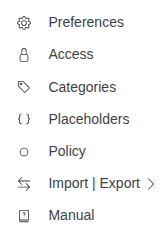
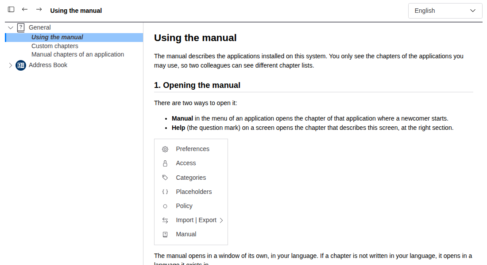
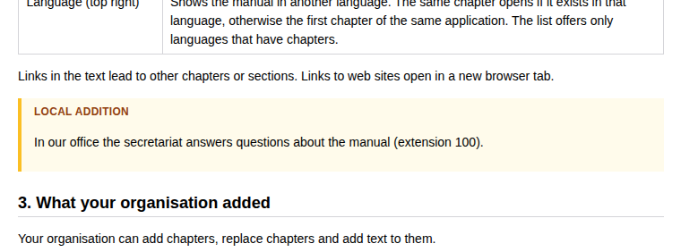

# Using the manual

The manual describes the applications installed on this system. You only see the chapters of the applications you
may use, so two colleagues can see different chapter lists.

## 1. Opening the manual

There are three ways to open it:

- **Manual** in the menu of an application opens the chapter of that application where a newcomer starts.
- **Help** (the question mark) on a screen opens the chapter that describes this screen, at the right section.
- **Manual** in the user menu (your picture, top right) opens the manual of the application you are in.

The manual opens in a window of its own, in your language. If a chapter is not written in your language, it opens in
a language it exists in.

## 2. The window

| Part | What it does |
|---|---|
| Chapter list (left) | One entry per application, its chapters below. A click on a chapter opens it. **General** holds the chapters that belong to no application. |
| Show or hide the chapter list (first button) | Hides the list to give the chapter more room. The manual remembers your choice. |
| Back / Forward (arrows) | Moves between the chapters you have opened, like a web browser. |
| Language (top right) | Shows the manual in another language. The same chapter opens if it exists in that language, otherwise the first chapter of the same application. The list offers only languages that have chapters. |

Links in the text lead to other chapters or sections. Links to web sites open in a new browser tab.

## 3. What your organisation added

Your organisation can add chapters, replace chapters and add text to them.

- Chapters it added or changed appear in *italics* in the chapter list.
- Text it added to a chapter appears in a framed box titled **Local addition**.

If the shipped text and the local addition say different things, follow the local addition: it describes how your
organisation works.

## 4. For administrators and developers

- Adding, replacing and hiding chapters: [Custom chapters](01-manual-custom-chapters.md).
- Writing the manual of an application: [Manual chapters of an application](02-manual-for-developers.md).
