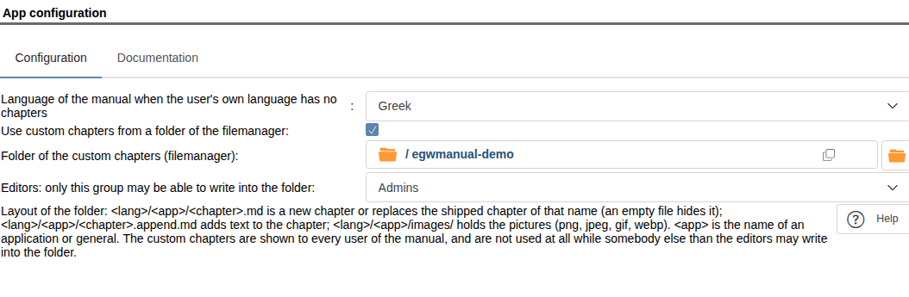
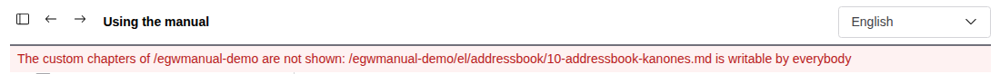

# Custom chapters

Administrators can complete the manual with their own text. The text is kept as Markdown files (`.md`) in a folder of
the filemanager. The applications do not have to change for it.

With custom chapters you can:

- add a chapter, also for an application that has no manual of its own (for example Address Book),
- replace a chapter of an application with your own version,
- hide a chapter,
- add text to a chapter, at its end or after one of its sections.

## 1. Setting up the folder

1. Create a folder in the filemanager, for example `/manual`.
2. Give write access to this folder **only** to the editors of the manual (by default the group Admins). The folder
   and everything in it has to belong to an editor or to root. No other user or group may write into it, neither
   through the rights of the folder nor through an extended ACL of the folder or of a folder above it.
3. Open **Admin › Manual › App configuration**, tick **Use custom chapters from a folder of the filemanager** and fill in:



| Field | What to enter |
|---|---|
| Use custom chapters from a folder of the filemanager | Tick it. It is off by default: then the folder is neither checked nor read, and its two fields are greyed out. |
| Language of the manual when the user's own language has no chapters | The language most of your chapters are written in. |
| Folder of the custom chapters (filemanager) | The folder of step 1, for example `/manual`. |
| Editors: only this group may be able to write into the folder | The group of the editors. Empty means Admins. |

Switched on, the configuration is only saved if the folder passes the check of step 2. The message names every file or folder
that fails it and why.

> Every user of the manual sees all custom chapters of the applications he may use, whatever his rights in the
> filemanager. Do not put anything into the folder that not all users may read.

## 2. Layout of the folder

| File | What it does |
|---|---|
| `<lang>/<app>/<chapter>.md` | A new chapter of the application, or the replacement of the application's chapter of the same name. |
| `<lang>/<app>/<chapter>.md`, empty | Hides the application's chapter of that name. |
| `<lang>/<app>/<chapter>.append.md` | Text added to the chapter (shipped, replaced or custom). |
| `<lang>/<app>/images/<picture>` | Pictures of these chapters: png, jpeg, gif or webp. |

- `<lang>` is a language code: `en`, `de`, `el`, `pt-br` …
- `<app>` is the name of an application (`addressbook`, `calendar`, `infolog` …) or `general` for chapters that belong
  to no application. A chapter of an application is shown only to users of that application.
- `<chapter>` uses lower-case letters, digits and hyphens only, for example `10-addressbook-our-rules`. The chapters
  are listed in the order of their names, so start them with a number.

Chapter names are the same in every language: a translation of a chapter has the same file name in the folder of the
other language. To replace or hide a chapter of an application, use its file name (the Help buttons link to it by
that name), in the folder of the same application. The name of a chapter can be found in the address of the manual
window (`page=…`).

Example:

```
/manual
  en/
    general/
      05-our-office-hours.md
    addressbook/
      10-addressbook-our-rules.md
      images/
        new-contact.png
    infolog/
      20-infolog-intro.md          (empty: hides that chapter)
      21-infolog-states.append.md
```

## 3. Writing a chapter

The first heading (`# Title`) is the title in the chapter list. The manual shows this part of Markdown:

- headings `#` to `######`, paragraphs, lists (also numbered and nested), tables, quotes `>`, code in backticks and
  fenced code blocks, **bold**, *italics*, horizontal lines `---`;
- links to other chapters: `[text](10-addressbook-our-rules.md)` or with a section
  `[text](10-addressbook-our-rules.md#2-who-may-edit)`; links to web sites starting with `https://`;
- pictures: ``.

HTML in a chapter is shown as text, never executed. Links of other kinds (`javascript:`, `data:`, paths) are shown as
plain text. Pictures from other web sites are not shown: they would let that site see who reads which chapter.

The section anchor of a heading is formed like on GitHub: lower case, spaces become hyphens, punctuation is dropped
(`## 2. Who may edit` → `2-who-may-edit`).

A file may have at most 512 KB, a picture at most 5 MB.

## 4. Adding text to a chapter

A file `<chapter>.append.md` is added at the end of the chapter. To insert it after a section instead, start it with

```
<!-- after: 2-who-may-edit -->
```

The text then appears after that section, before the next heading of the same or a higher level. If the section does
not exist (any more), the text is added at the end. Readers see it in a box titled **Local addition**.

An append is the better choice when you only want to add your organisation's rules: the shipped chapter stays up to
date with every new version, while a replaced chapter does not.

## 5. Tables computed by the applications

Some chapters contain tables the application computes from its own setup (for example its statuses). They are marked
like this:

```
<!-- live: <app>.<name> -->
Text shown where the table cannot be computed.
<!-- /live -->
```

Such a block may also be used in a custom chapter. It is filled in only for users of that application.

## 6. When custom chapters do not show

| What you see | Reason | What to do |
|---|---|---|
| No custom chapter at all, and no warning | **Use custom chapters from a folder of the filemanager** is not ticked. | Tick it and save the configuration. |
| A red line at the top of the manual window (administrators only) | Somebody else than the editors can write into the folder. All custom chapters are switched off. | Fix the rights the line names. The chapters return within five minutes, at once after saving the configuration again. |
| A chapter is missing | Wrong folder (`<lang>/<app>/`), a name with capitals, spaces or Greek letters, or the user does not have the application. | Rename or move the file. |
| A replaced chapter shows the original text | The file is in the folder of another application than the original chapter. | Move it into the folder of the chapter's application. |
| A picture is missing | Not png, jpeg, gif or webp, its content is not of that type, or it is not directly in `images/`. | Save it again as png or jpeg. |


